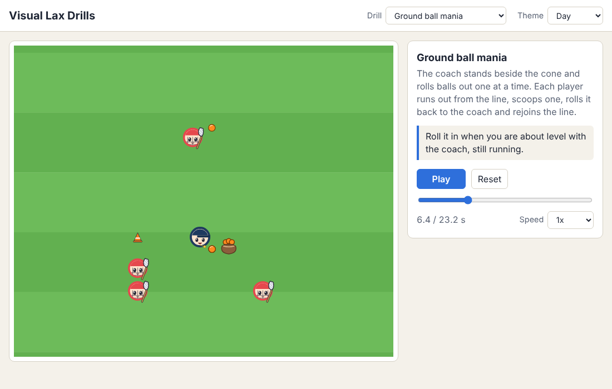
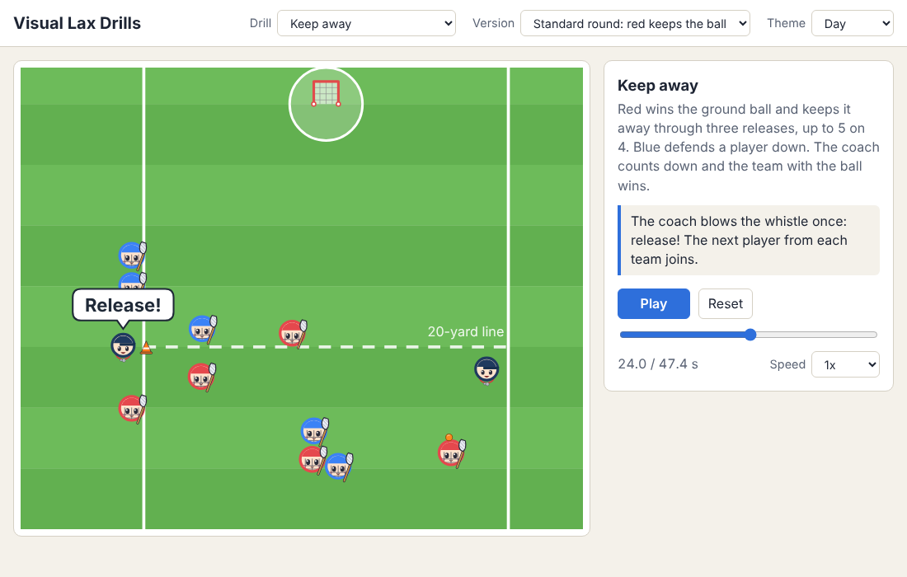
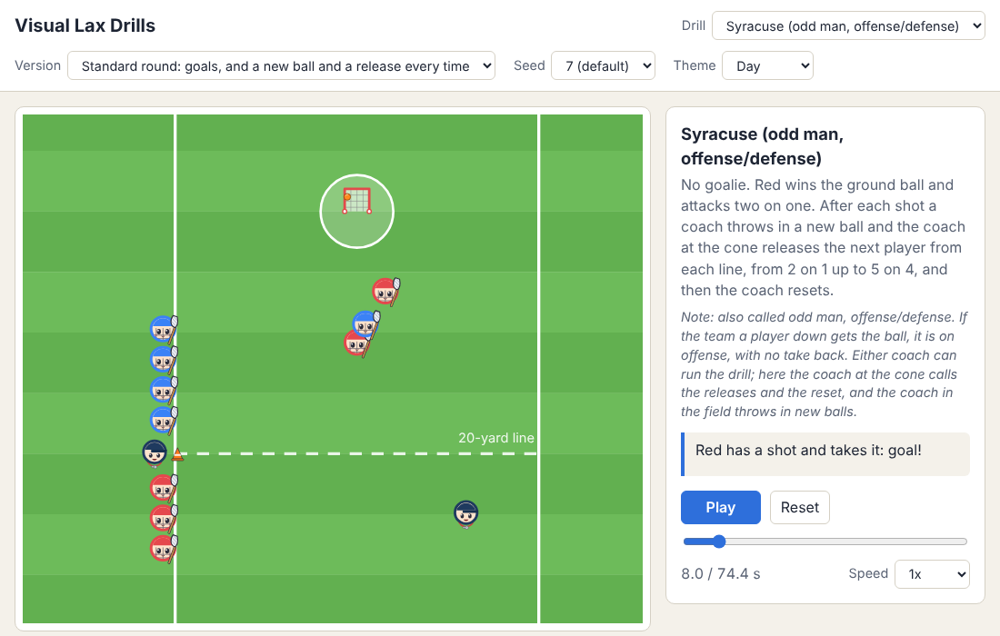
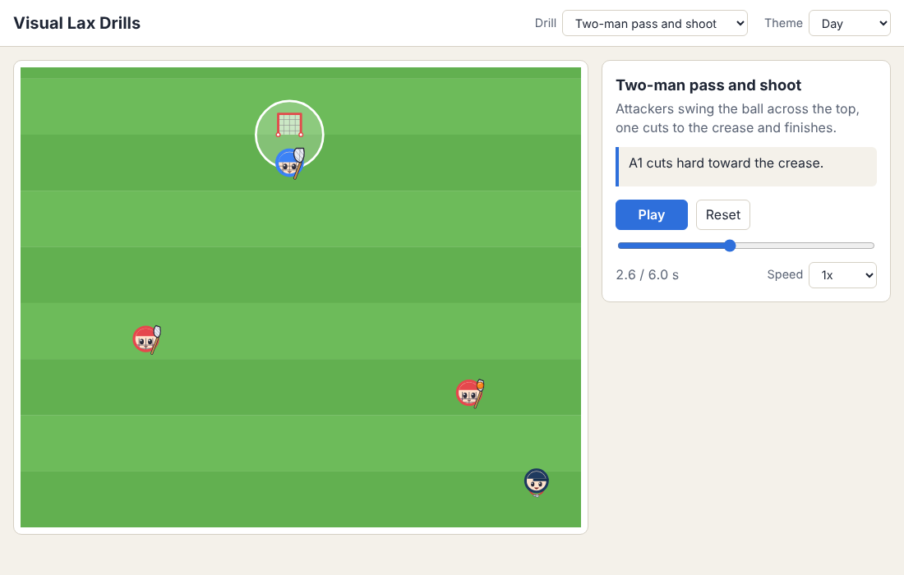
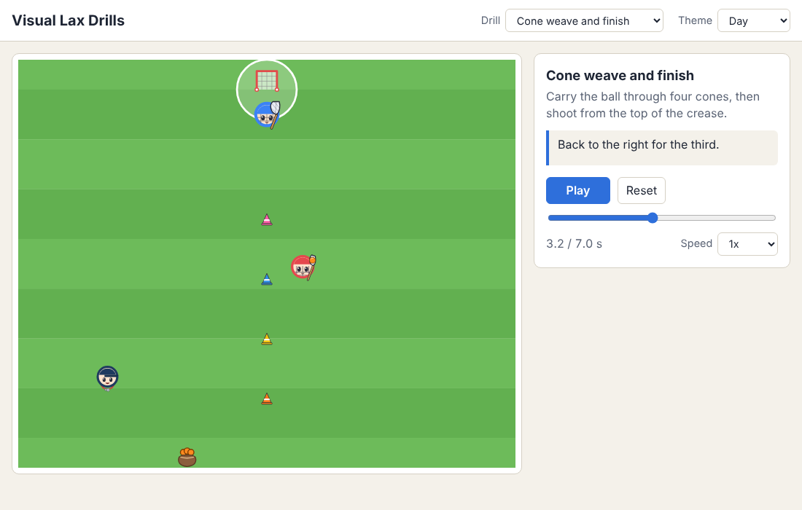
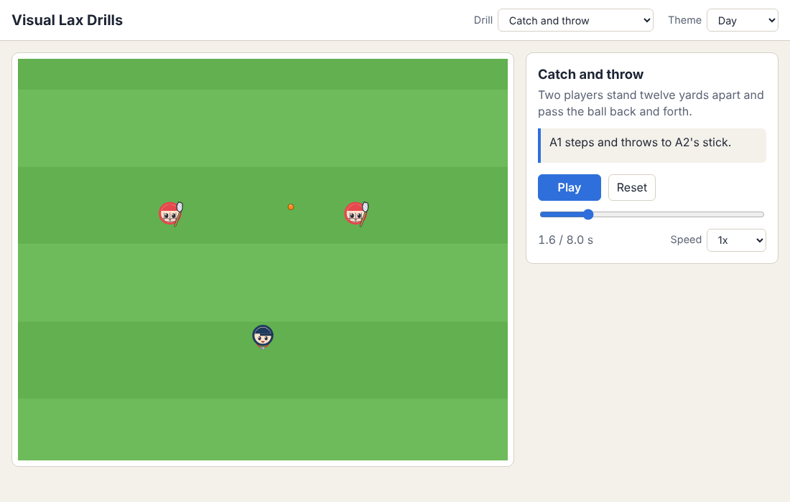
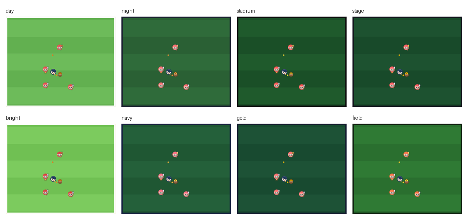
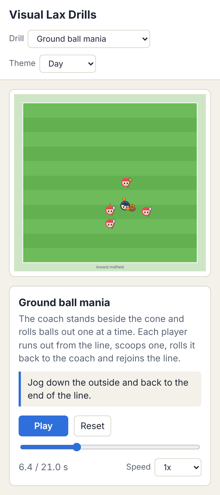

# Visual Lax Drills

Animated lacrosse drills in a single static HTML file, drawn with anime chibi style icons (players,
goalies, coaches, nets, balls, cones). Pick a drill, then play, pause, scrub, change the speed, or
switch themes.

**Live site:** <https://vibecoder-1z3r0.github.io/visual-lax-drills/> (published from `main` by the
CI workflow; it needs Pages set to "GitHub Actions" as the source in the repository settings).



*Ground ball mania: the coach stands beside the cone and rolls balls up the field. Each player runs
out, scoops one, rolls it back to the coach on the run and rejoins the line, all circling clockwise.*

## Drills

| Drill | What it shows |
|---|---|
| Ground ball mania (the default) | A line of four scoops balls rolled out by the coach, one after another. |
| Keep away | Five a side on the sideline; two red and one blue chase a rolled ball, then play keep-away. A whistle releases one more from each line (up to 5v4); a countdown from 5 ends the round. Five versions (Version menu), each with five seeds (Seed menu) that play out differently. |
| Syracuse (odd man, offense/defense) | Like keep away, but whoever has the ball is on offense and shoots when there is a shot, at a goalie. After a goal: a new ball, a reset, or a new ball plus a release. Five versions (the goalie is optional), each with five seeds. |
| Two-man pass and shoot | Attackers swing the ball across the top, one cuts to the crease and finishes. |
| Cone weave and finish | Carry the ball through four cones, then shoot from the top of the crease. |
| Catch and throw | Two players twelve yards apart pass the ball back and forth. |

| | |
|---|---|
|  |  |
|  |  |
|  | |

## Themes

Eight themes, chosen from the Theme menu and remembered between visits. Here they are on the same
frame:



## On a phone

The page works at phone width: the field first, then the controls.



## Use it

Open `dist/index.html` in a browser after building, or use the live site above. There is no server
and no runtime dependency. The Seed menu of keep away and odd man loads each extra seed from the
`takes/` folder next to the page the first time you pick it (the default seed is in the page itself,
so the page still plays if that folder is missing).

## Develop

```bash
make setup        # one time: virtualenv, dev tools, Playwright's Chromium
make build        # src/ -> dist/index.html
make lint         # deno lint, HTML check, ruff
make test         # Playwright (Python) tests against dist/index.html
make serve        # serve dist/ at http://127.0.0.1:8000 (it also opens straight from disk)
make screenshots  # remake docs/screenshots/ for this README
```

Tests write screenshots to `test-artifacts/`. Add a drill by adding data to `src/js/drills.js`; add
or replace art by editing `src/icons/` (or dropping files in `icons-custom/`, which is git-ignored).
See `AGENTS.md` for the plan and the rules for agents working in this repo.

### Session log

`make session-log` writes a turn-by-turn timing report for the current Claude Code session to
`session-logs/<session start>.md`: how long the agent worked on each request, how long the human took
to reply, and token use. Each prompt is cut to 70 characters after secret-shaped strings, emails and
Claude session links are redacted. `make setup` (or `make hooks`) points git at `scripts/hooks`, whose
`pre-commit` hook refreshes the log and adds it to every commit; it does nothing where there is no
session transcript, such as CI. Each session writes its own file, so a later one never overwrites an
earlier one. Don't edit the logs by hand.

### Keeping the screenshots current

The pictures above live in `docs/screenshots/` and are made by `scripts/screenshots.py`. A saved hash
of `src/` sits next to them, and a test (`tests/test_screenshots_current.py`) fails when `src/` has
changed since they were made. So after any change that could alter how the page looks (drills, icons,
styles, layout), run `make screenshots` and commit the new images with the change. Add a new drill
to the list at the top of `scripts/screenshots.py` so it gets a picture too.
